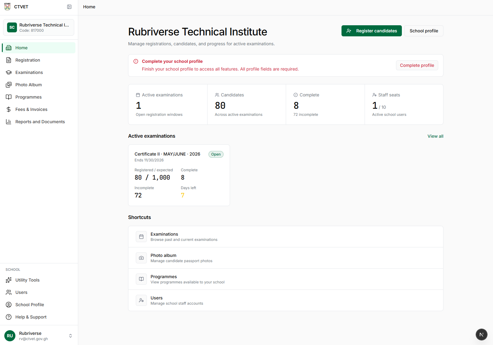
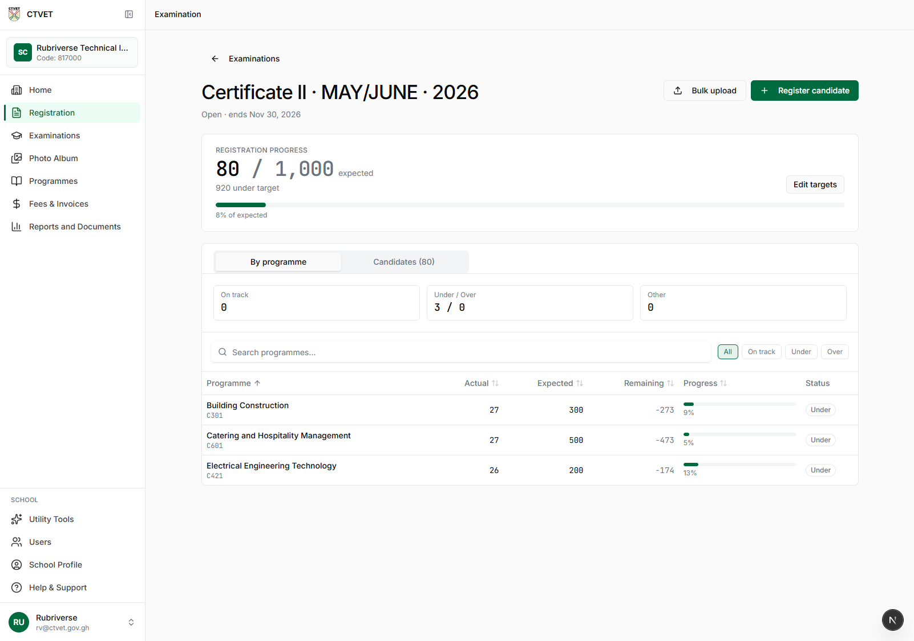
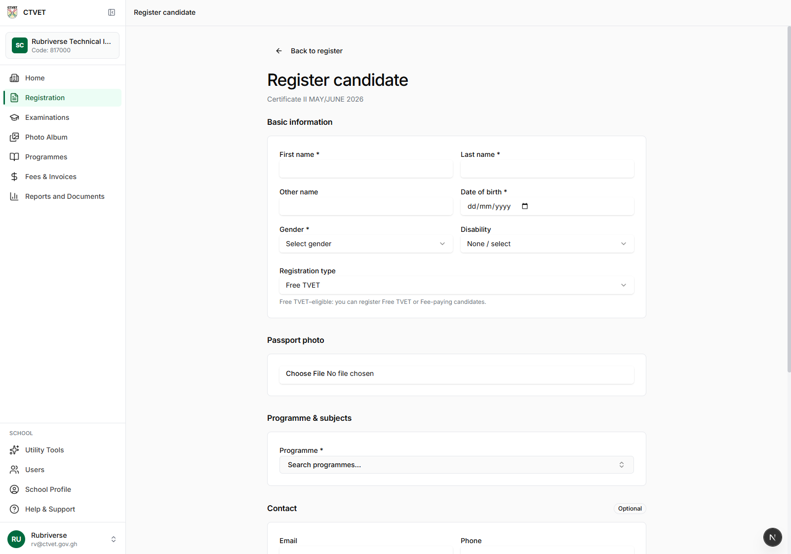
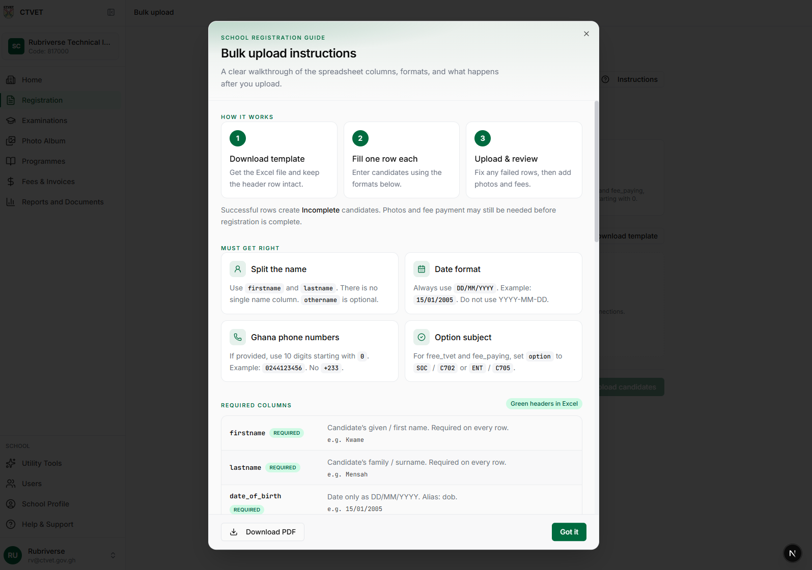
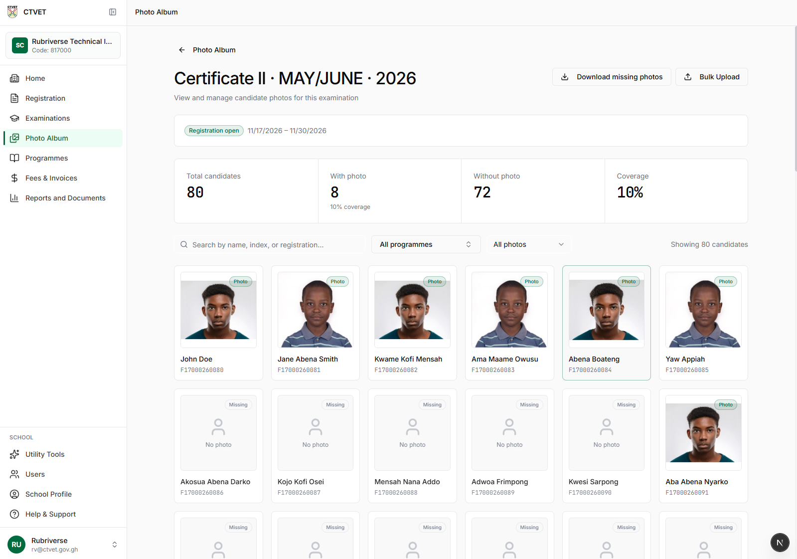
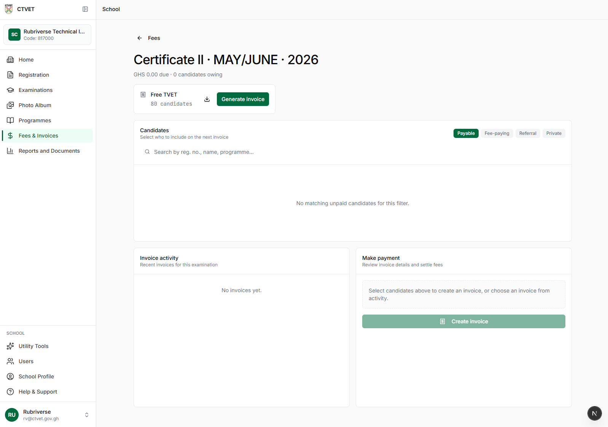
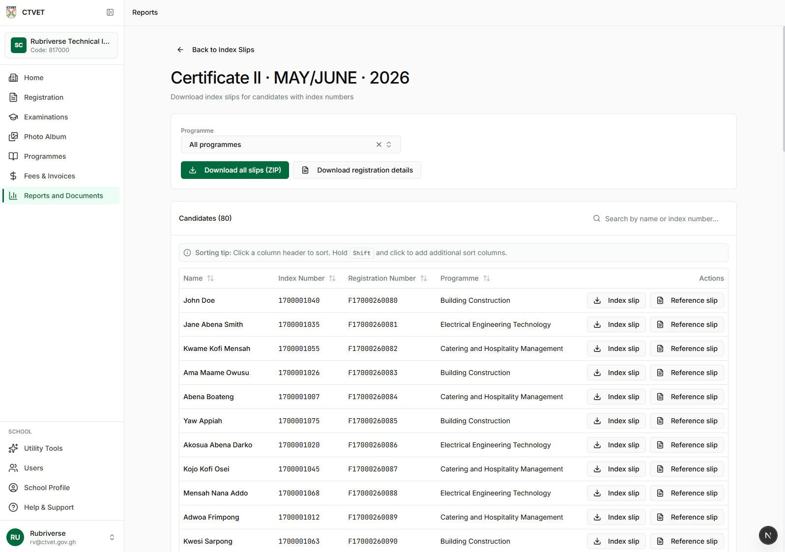
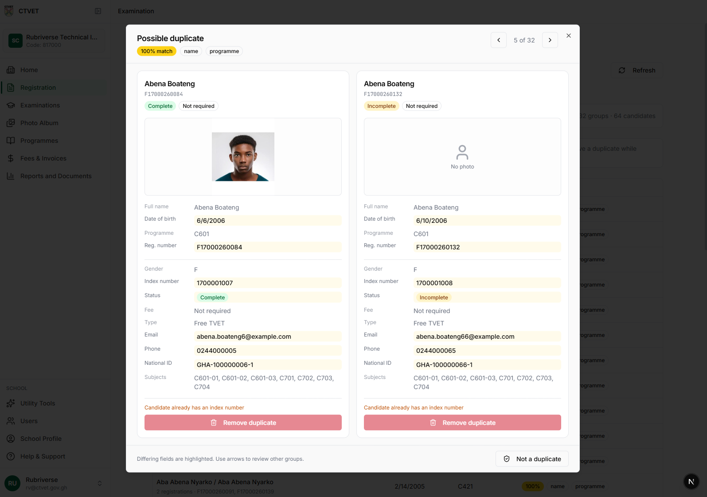

# School Registration User Manual

Guide for **School Administrators** and **Support Staff** who register candidates for examinations.

You can read this manual in **Help & Support** in the portal, or download a PDF from that page.

---

## 1. Introduction and roles

### Who this manual is for

| Role | Typical title | What you can do |
|------|---------------|-----------------|
| **School Administrator** | School coordinator | Full school registration workflows, manage programmes, manage support staff users |
| **Support Staff** | School user | Same registration, photos, fees, and reports as the School Administrator, except Users management and programme association |

### Sign in

1. Open the registration portal login page.
2. Enter your **email** and **password**.
3. After a successful login you are taken to **Home** (`My School`).

If you see “Your session has expired,” sign in again.

### Main menu

| Menu item | Purpose |
|-----------|---------|
| **Home** | School overview and open exams |
| **Registration** | Register candidates, self-declaration, duplicates |
| **Examinations** | Browse exams your school is eligible for |
| **Photo Album** | View and upload candidate photos |
| **Programmes** | View (or manage, if coordinator) programmes |
| **Fees & Invoices** | Create invoices and pay registration fees |
| **Reports and Documents** | Index slips, reference slips, timetables |
| **Utility Tools** | Resize, validate, and prepare photos |
| **Users** | *(School Administrator only)* Create and manage support staff |
| **School Profile** | School details |
| **Help & Support** | This manual and PDF download |

### Registration completeness

A candidate is **Complete** only when **both** are true:

1. A valid **passport photo** is on file, and
2. The **fee** is satisfied (**Paid**, **Waived**, or **Not required**).

Otherwise the candidate stays **Incomplete** (or **Draft** in uncommon cases). Free TVET candidates have fee **Not required**, but they still need a photo to become Complete.

---

## 2. Getting started

### Home dashboard

On **Home** you can see:

- School name and key counts
- Open examinations with registration shortcuts
- Links to register, manage photos, fees, and (for coordinators) school users

### Complete your school profile

If the portal asks you to **complete your school profile**, open **School Profile** and fill every required field before continuing with registration.

### Pick an examination

1. Go to **Registration** (or open an exam card from **Home**).
2. Choose the examination that is open for your school.
3. You land on the **exam registration workspace**, where you set targets, register candidates, and track progress.

Registration actions (register, bulk upload, photo upload, expected numbers) are available only while registration is **open** for your school.

---

## 3. Self-declaration and progress monitoring

Self-declaration lets you set **expected registration numbers** so you can track progress. It is **optional** and does **not** block registration.

### Set expected numbers

1. Open **Registration** → select the examination.
2. In the registration progress area, choose **Set expected numbers** (or **Edit targets** if targets already exist).
3. Enter an **Overall expected total** (whole number, at least 1), and/or counts **by programme**.
4. If you use programme counts, you can choose **Use programme sum** to fill the overall total.
5. If both overall and programme counts are set, the **programme sum must equal the overall total**.
6. Save. To remove targets, use **Clear** when a declaration already exists.

You can only edit targets while registration is open for your school.

### Monitor progress

The **Registration progress** pulse shows:

- With targets: **actual / expected**, a progress bar, and status **On track**, **under target**, or **over target**
- Without targets: how many candidates are registered, plus a prompt to set targets

Use the **By programme** tab to see which programmes are on track, under, or over. Use the **Candidates** tab for registered / complete / incomplete counts and **Find duplicates**.

**Tip:** Set realistic targets early, then use Incomplete counts and missing-photo reports to finish registration before the period closes.

---

## 4. Register a candidate (single form)

Use single entry when you have a few candidates or need careful subject selection (for example referral).

### Steps

1. Open **Registration** → select the examination.
2. Choose **Register candidate**.
3. Fill required identity fields:
   - First name, last name
   - Date of birth
   - Gender
   - Programme
4. Choose the **registration type** allowed for this exam and school:
   - **Fee-paying** — usual paying school candidate
   - **Free TVET** — only where your school/exam allows Free TVET
   - **Referral** — only if the exam allows referral registration
   - **Private** — for private examinations (type is fixed on private exams)
5. Confirm **subjects** (at least one). For fee-paying and Free TVET, subjects are usually filled from the programme. Referral (and private) often need explicit subject selection.
6. Optionally add other name, disability, contact details, guardian details, and a passport photo.
7. Submit.

If the photo fails at submit time, the candidate is still created; upload the photo later from the candidate details or Photo Album.

### Private examinations

On private exams you must also select an **examination center**. Guardian details are recommended.

### After submit

New candidates are typically **Incomplete** until photo and fee requirements are met. Open the candidate from the Candidates tab to edit details or upload a photo while registration remains open.

---

## 5. Bulk registration

Use bulk upload when you have many candidates in a spreadsheet.

### Before you start

- Registration must be **open**.
- The examination must allow bulk registration. If it does not, upload will be rejected.
- Your school must have programmes available for the exam.

### Steps

1. Open the exam registration workspace → **Bulk upload**.
2. Choose the default **registration type** for rows that do not specify a type (on private exams, type is always private).
3. **Download the Excel template** (and optionally the instructions PDF).
4. Fill one candidate per row. Format phone and ID columns as **text** so leading zeros are kept.
5. Optionally **Validate file** first (does not create candidates).
6. Choose **Upload candidates**. The portal uploads in small batches (about 25 rows) with automatic retry on poor connections.
7. Review the results table. Download the **results Excel** if you need an error report.

### Required columns

| Column | Notes |
|--------|--------|
| `firstname` | Required |
| `lastname` | Required |
| `date_of_birth` | `DD/MM/YYYY` (alias `dob` accepted) |
| `gender` | Required |
| `programme_code` | Alias `programme` accepted |
| `option` | Required for **fee-paying** and **free_tvet**: `SOC` / `C702` or `ENT` / `C705` |
| `subject_codes` | Required for **private** exams (and for referral when subjects are not implied) |

Optional columns include contact fields, guardian fields, and `registration_type` per row.

### Phone numbers

If a phone is provided it must be **10 digits starting with 0** (do not use +233).

### After bulk upload

Candidates are created as **Incomplete**. Continue with photos and fees as needed.

---

## 6. Photos

### Photo rules

| Rule | Requirement |
|------|-------------|
| Format | **JPEG** (PNG may be accepted in some single-upload paths; bulk album expects JPEG) |
| Size | Exact **155 × 191** pixels |
| File size | Maximum **2 MB** |
| Content | Clear face; white or off-white background preferred (strict validation) |

Each candidate has one photo. A new upload replaces the previous photo. Files are stored using the candidate’s registration number.

### Single photo

1. Open the candidate from the exam Candidates list (or during single registration).
2. Upload a passport photo that meets the rules above.
3. Save. Completeness updates when the photo is accepted (and fee is already satisfied).

### Bulk photo upload (Photo Album)

1. Go to **Photo Album** → select the examination.
2. Open **Bulk upload** (only while registration is open).
3. Select many JPEG files named as:
   - the **full registration number**, or
   - the **last 4 characters** of the registration number
4. Review successes and errors. Fix unmatched or ambiguous filenames and retry.
5. Use filters (programme, with/without photo, search) to find gaps.
6. Optionally download the **missing photos** PDF.

### Utility Tools (prepare photos offline)

Go to **Utility Tools** to:

- **Resize** images to 155 × 191 (optional keep aspect ratio) and download a batch
- **Validate** photos at Basic / Standard / Strict levels and download a results ZIP
- **Replace background** with a chosen colour (default white) before uploading to the album

Prepare files here, then upload through Photo Album or single candidate upload.

---

## 7. Fees and payments

Payable registration types: **fee-paying**, **referral**, and **private**.
**Free TVET** candidates have fee **Not required** — payment is not needed for completeness (photo is still required).

### Open the fees workbench

1. Go to **Fees & Invoices**.
2. Select the examination.
3. Review unpaid / payable candidates. Filter by payable types as needed.

### Create an invoice

1. Select the unpaid candidates to include (or use shortcuts such as invoice outstanding fee-paying / referral / private).
2. Choose **Create invoice**.
3. Download the invoice PDF if you need a paper or email copy.

Candidates already on an open invoice cannot be placed on a new invoice until that invoice is paid, cancelled, or (for bank deposit) resolved.

### Payment methods

#### A. Mobile Money or Visa Card

1. Open the invoice payment actions.
2. Choose **Pay with Mobile Money or Visa Card**.
3. Complete payment with Mobile Money or Visa Card.
4. On success, included candidates are marked **Paid** and completeness can move to Complete (if photos are present).

#### B. Bank deposit

1. Pay at the bank using the details on your invoice / instructions from the examining body.
2. In the portal, choose **Bank deposit**.
3. Upload the **pay-in slip** (image or PDF). Optionally enter deposit reference and amount.
4. Submit. Invoice status becomes **awaiting bank confirmation**.
5. Wait for CTVET/admin staff to **approve** the deposit. Until then you will see that the pay-in slip was submitted and is waiting for confirmation.
6. After approval, candidates are marked **Paid**.

#### C. Free TVET documentation invoice

Where offered, you may generate a **Free TVET** invoice for records. It is **download-only** — payment is not required.

### After payment

Confirm Candidates / Fees views show **Paid** (or **Not required** for Free TVET). Finish any missing photos so candidates become **Complete**.

---

## 8. Index slips and reference slips

Index numbers are assigned by the examining body after registration processing. You can only download slips for candidates who **already have index numbers**.

### Where to download

1. Go to **Reports and Documents**.
2. Open **Index Slips**.
3. Select the examination.
4. Filter or search by programme, name, or index number as needed.

### Index slip

- Download one candidate’s **index slip**, or
- Download a **ZIP** of index slips for the filtered list.
- Optionally tick **Include registration number on index slips** (off by default).

### Reference slip / registration details

- Per candidate: **Reference slip** downloads a registration-details PDF (candidate card with registration number and photo).
- Bulk: **Download registration details** produces a PDF of registration-detail cards **without** the examination timetable.

If a candidate does not appear in the list, they likely do not have an index number yet. Contact the examining body or wait until index generation is finished.

---

## 9. Detect and delete duplicates

### Open duplicate detection

1. Open **Registration** → select the examination.
2. On the **Candidates** tab, choose **Find duplicates**.

### Scan options

- **Same date of birth** — on by default; tightens matches.
- **Same programme only** — optional; limits groups to one programme.

Matching looks for **similar names** (spelling and word order can vary) and shows a match percentage and reasons.

### Review a group

1. Open a duplicate group.
2. Use **Compare** for a side-by-side view.
3. Decide whether they are the same person.

### Mark as not duplicates

Choose **Not a duplicate** to hide that pair. If you later **edit either candidate’s identity**, the “not duplicate” mark is cleared and they may appear again.

### Delete a duplicate

1. Keep the correct registration.
2. **Remove** the incorrect one. Deletion is permanent.

You **cannot** delete a candidate when:

- Registration is **closed**, or
- The candidate already has an **index number**, or
- The fee is **paid** or **waived**.

Resolve fees and duplicates while registration is still open whenever possible.

---

## 10. Programmes, users, and school profile

### Programmes

- **Support Staff:** view programmes associated with your school.
- **School Administrator:** manage / associate programmes your school offers for registration.

Candidates must use a programme that is valid for the examination.

### Users (School Administrator only)

1. Open **Users**.
2. Create school staff accounts for colleagues who will register candidates.
3. Share login details securely; staff should change passwords according to your organisation’s practice.

### School Profile

Keep school contact and profile information up to date. Incomplete profiles can block full use of the portal.

---

## 11. Suggested end-to-end workflow

1. Confirm **School Profile** is complete.
2. Open the examination under **Registration**.
3. Set **expected numbers** (self-declaration) to guide progress.
4. Register candidates (**single form** and/or **bulk upload**).
5. Run **Find duplicates** and clean up before paying.
6. Upload **photos** (single or bulk); use **Utility Tools** to prepare files.
7. Create **invoices** and pay via **Mobile Money or Visa Card** or **bank deposit**.
8. Watch progress until candidates are **Complete** and counts match your targets.
9. After index numbers are issued, download **index slips** and **reference slips** from Reports.

---

## 12. Troubleshooting

| Problem | What to try |
|---------|-------------|
| Cannot register or upload | Check that registration is **open** for your school and exam. |
| Bulk upload rejected | Confirm the exam allows bulk registration; fix required columns and `option` / `subject_codes`. |
| Photo rejected | Use JPEG, exact **155×191**, max **2 MB**, clear face, light background. |
| Bulk photos unmatched | Rename files to full registration number or last 4 digits; avoid two candidates sharing the same last-4. |
| Cannot create invoice | Candidate may already be on an open invoice, already paid, or Free TVET (not payable). |
| Bank deposit stuck | Status **awaiting bank confirmation** means admin must approve the slip; wait or contact support with your reference. |
| Candidate not Complete | Check photo missing and/or fee unpaid. |
| Cannot delete duplicate | Registration closed, index number assigned, or fee paid/waived — deletion is blocked. |
| No index slips listed | Index numbers not generated yet for those candidates. |
| Session expired | Sign in again. |
| Missing Users menu | Only **School Administrators** see Users. |

---

## 13. Quick reference — statuses

### Candidate registration status

- **Complete** — photo present and fee satisfied
- **Incomplete** — missing photo and/or fee
- **Draft** — uncommon on school flows; treat as unfinished

### Fee payment status

- **Not required** — Free TVET (and similar)
- **Unpaid** — payment still needed
- **Paid** — fee settled
- **Waived** — fee waived by authorised process

### Invoice status (fees)

- **Draft** / **Pending** — invoice created; payment not finished
- **Awaiting bank confirmation** — pay-in slip submitted, waiting for admin
- **Paid** — payment complete
- **Cancelled** — invoice no longer valid

---

*End of School Registration User Manual*
