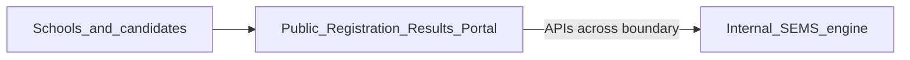

# Presentation video copy — SEMS solution (public Registration & Results Portal)

**Type:** Presentation video
**Audience:** CTVET decision-makers (AA&C, ICT, Executive)
**Focus:** Public-facing Registration and Results Portal (within the two-system SEMS solution)
**Target length:** ~4–4.5 minutes spoken
**Format:** On-screen headline + voice-over (VO)

---

## How to use this script

- **On screen:** short headline / bullets only.
- **VO:** read the spoken lines.
- **Timing:** each slide is roughly 20–30 seconds unless noted.
- **Product framing:** The **Smart Examination Management System (SEMS) solution** replaces CTVET’s obsolete system. It is two interconnected systems — a public **Registration and Results Portal** and an internal **SEMS** engine — on separate networks/platforms, linked by APIs, deployed independently. This presentation dives into the public portal; it does not tour internal SEMS features.

---

## Slide 1 — Opening hook (~25s)

**On screen**
- CTVET’s obsolete system was not built for today’s scale
- Schools and candidates feel every gap

**VO**
The Commission for Technical and Vocational Education and Training still depends on an obsolete examination system — one that was never designed for the scale of registration and results CTVET runs today. Schools fight the portal. Candidates disappear from registers. Index numbers go missing. Results feel fragile online. CTVET needs a replacement built for the volume and complexity of modern sittings — not another patch on yesterday’s software.

---

## Slide 2 — The SEMS solution: two systems, one architecture (~35s)

**On screen**
- Smart Examination Management System (SEMS) solution
- Public: Registration and Results Portal
- Internal: SEMS engine — not publicly accessible
- Separate networks · Linked by APIs · Deployed independently
- This presentation focuses on the public portal

**Diagram cue**

Label on screen: public network vs internal network.

**VO**
Our answer is the Smart Examination Management System solution — two interconnected systems working as one. On the public side: the Registration and Results Portal, where schools, private candidates, and the public meet CTVET. On the inside: the SEMS engine — the examination management core — deployed on a separate network, not accessible from the public internet. The two talk across boundaries through secure APIs. Each can be deployed and scaled independently. This presentation focuses on the public-facing portal — the face of the replacement.

---

## Slide 3 — The public portal promise (~30s)

**On screen**
- Registration and Results Portal
- Modern. Responsive. User-friendly.
- Built for remote schools with poor connectivity
- Secure. Scalable. Built for today’s sittings.

**VO**
The Registration and Results Portal is modern, responsive, and user-friendly — built for phones, tablets, and desktops. It is designed for schools in remote areas with poor internet connectivity, so registration and results still work when the connection is slow or unreliable. Schools register. Private candidates enrol. The public checks results. One public platform, designed for peak load, for the examination scale CTVET operates now.

---

## Slide 4 — Registration that feels easy (~30s)

**On screen**
- School portal and private candidate flows
- Single form or bulk spreadsheet upload
- Photos, fees, and live progress
- Works on phone, tablet, and desktop

**VO**
Schools register through a clean portal: set expected numbers, add candidates one by one or in bulk from a spreadsheet, upload passport photos, and settle fees with clear invoices and payment options. Private candidates follow a guided multi-step path. Coordinators see live progress — who is complete, who still needs a photo or payment. Registration stops feeling like a struggle and starts feeling like a finished job.

---

## Slide 5 — Utility Tools: passport photos done right (~30s)

**On screen**
- Resize to required passport dimensions
- Face and background detection
- Background replace to white / off-white
- Blocks selfies, dog heads, and other non-passport photos

**VO**
Passport photos make or break slips and certificates. Built-in Utility Tools let schools resize images to the required dimensions, run face and background detection at Basic, Standard, or Strict levels, and replace unsuitable backgrounds with a proper light or white backdrop before upload. Validation stops people uploading selfies, dog heads, and other non-passport photos — so only clear, exam-ready candidate photographs enter the register.

---

## Slide 6 — Any examination, one portal (~30s)

**On screen**
- Highly configurable examination setup
- Certificate II · Traditional · Technicians
- Programmes, subjects, fees, examination windows, eligibility

**VO**
This is not a one-exam tool. It is a highly customisable portal for setting up and running any examination registration. Configure Certificate II examinations, Traditional programmes, Technicians programmes, and other series the same way: programmes and subjects, fee rules, examination windows, and school eligibility. Open a new Sitting without rebuilding the system — configure it and go.

---

## Slide 7 — A clean register — no doubles, no missing candidates (~35s)

**On screen**
- Completeness: photo + fee before “complete”
- Eliminates double registration
- Validation at entry — no silent gaps
- One authoritative register at close

**VO**
Integrity of the register is non-negotiable. A candidate is complete only when a valid photo is on file and the fee is paid, waived, or not required. The platform detects and resolves duplicate and repeat registrations before close, eliminating double registration from the final list. Validated entry and clear incomplete views mean candidates are not lost between the school’s screen and the closed register. What you close is what you have — complete, and accounted for.

---

## Slide 8 — Index numbers after the examination window closes (~30s)

**On screen**
- Examination window closes first
- Then index numbers are issued
- Full coverage — no missing index numbers
- Schools download index and reference slips

**VO**
Index numbers are issued after the examination window closes — not mid-stream, not ad hoc. When registration ends, the system generates index numbers across the closed register so every eligible candidate receives one. No missing index numbers. Schools then download index slips and reference slips from the portal, confident the list matches the candidates they registered.

---

## Slide 9 — Public results, under control (~25s)

**On screen**
- Publish when the board is ready
- PIN and serial access for candidates
- Modern results check experience
- Holds for cases under review

**VO**
When results are ready, the board publishes them through the same portal. Candidates check online with a PIN and serial on a modern, responsive screen. Access is controlled; disputed cases can be held. The public never sees a draft — only what CTVET has authorised to release.

---

## Slide 10 — Close: replace the obsolete system (~25s)

**On screen**
- Replace CTVET’s obsolete system
- Public portal at the edge · Internal SEMS at the core
- Built for today’s scale — including remote schools
- Ready for the next Sitting

**VO**
This is the presentation: replace CTVET’s obsolete system with a SEMS solution built for the scale of today’s examinations — including schools in remote areas with poor internet connectivity. A modern Registration and Results Portal on the public side. An internal SEMS engine behind the boundary. Linked by APIs. Deployed independently. Utility Tools that keep passport photos legitimate. No double registrations. No missing candidates. Index numbers after the examination window closes — with none left behind. Results the public can trust. Ready for Certificate II, Traditional, Technicians — and the next Sitting.

---

## Appendix A — Producer beat sheet

| Slide | Message |
|-------|---------|
| 1 | Opening hook: obsolete system vs today’s scale |
| 2 | Two-system SEMS architecture; public focus of this video |
| 3 | Public portal promise + remote / poor connectivity |
| 4 | School + private registration UX |
| 5 | Utility Tools: resize, face/background validation; no selfies or dog heads |
| 6 | Multi-exam / Sitting configurability (Cert II, Traditional, Technicians) |
| 7 | Eliminate doubles; no missing candidates |
| 8 | Index after examination window closes; no missing index numbers |
| 9 | Public results: publish + PIN/serial |
| 10 | Close: replace obsolete system; scale; remote; next Sitting |

---

## Appendix B — Suggested B-roll / UI cues

- Architecture diagram (public portal ↔ APIs ↔ internal SEMS; “not publicly accessible”)
- Contrast beat: “obsolete system” vs modern responsive UI
- Remote / low-bandwidth cue (mobile on weak signal, still completing a step)
- School Home / registration workspace on desktop and mobile
- Single register form and bulk upload
- Utility Tools: resize, validate (face/background), background replace; rejection of selfie / pet photo
- Photo Album / completeness filters
- Fees & Invoices payment flow
- Find duplicates resolution
- Admin exam / programme / examination-window configuration
- Index number generation; index / reference slip PDF
- Public results check (PIN + serial)

---

## Appendix C — Spoken length

Main VO (slides 1–10): ~650–730 words → about **4–4.5 minutes** at a clear presentation pace. Hold Slide 2 on the architecture diagram and Slide 5 on photo validation demos if needed.
]
